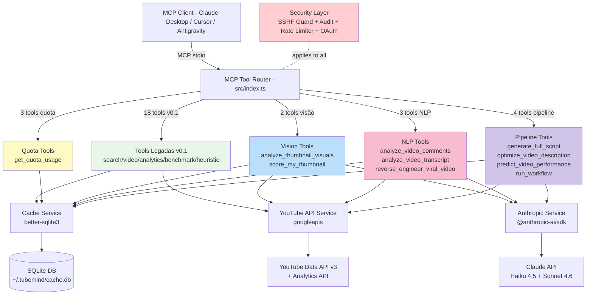

# BLUEPRINT: Tubemind v0.2 — MCP Server (4 Camadas)

> **Gerado a partir de:** 4 DESIGNs aprovados em `DARE/designs/` (camadas 1-4)
> **Data:** 2026-05-23 | **Status:** DRAFT → APROVADO
> **Modelo gerador:** Haiku 4.5 (recomendado re-rodar em Opus 4.7)
> **Tools v0.1:** 18 | **Tools v0.2:** 28 (10 novas + 6 refatoradas)

---

## 1. VISÃO GERAL DA ARQUITETURA

**Padrão arquitetural:** Hexagonal (Ports & Adapters) com 4 camadas verticais e infraestrutura horizontal compartilhada.



### Decisões Arquiteturais Principais

| # | Decisão | Escolha | Justificativa |
|---|---------|---------|---------------|
| D-01 | Padrão de módulos | **Hexagonal (Ports & Adapters)** | Já é o padrão do código v0.1; permite isolar Claude/YouTube/SQLite via interfaces; facilita testes com mocks. |
| D-02 | Storage de cache e quota | **SQLite local (better-sqlite3)** | Zero deps externas; synchronous (mitiga race conditions); WAL mode; binário prebuilt. Justifica RNF-1.8 "tiny footprint". |
| D-03 | Cliente LLM | **`@anthropic-ai/sdk` direto** (sem abstração) | Vendor lock-in aceitável; mudança para Vertex AI no futuro é refator manual de 3 arquivos. |
| D-04 | Tier de modelo | **Haiku 4.5 (default) + Sonnet 4.6 (transcript/script)** | Custo 10x menor em Haiku; Sonnet só onde profundidade importa. Documentado em RNF-3.6, RNF-3.7, RNF-4.6. |
| D-05 | Estratégia de cache key | **`SHA-256(tool + paramsJSON + token_hash + tubemind_version)`** | Token hash garante isolamento (RS-1.3); version invalida cache em upgrade (R-1.4). |
| D-06 | Comunicação inter-tools | **Chamadas síncronas in-process** (Camada 4 invoca 2/3) | MCP é single-process; sem necessidade de IPC; mais simples e rápido. |
| D-07 | Batch fetch de vídeos | **`videos.list({id: [...50]})` em lotes de 50** | Limite oficial da API; reduz 50 chamadas → 1 (50x economia de quota). Cobre RF-1.7. |
| D-08 | Sanitização de prompts | **Wrapper XML estrito `<comment idx="N">...</comment>` + remoção de `<` adversário** | Mitigação dual: estrutura + escaping. Cobre RS-2.5, RS-3.1, RS-4.2. |
| D-09 | Imagens em Vision API | **Strip EXIF via `sharp` + base64 inline (não upload)** | Privacidade (RS-2.3); zero storage local (RNF-2.5). |
| D-10 | Tracking de custo | **Audit log estruturado com tag por tool + custo estimado** | Auditável; permite cap diário; integra com `get_quota_usage`. |
| D-11 | Backward compat v0.1 | **Cache + batch são transparentes** (mesma assinatura de tool) | Atende RNF-1.9; nenhuma quebra de contrato MCP. |
| D-12 | Falha de Anthropic API | **Fallback gracioso: tool retorna mensagem clara, não crash** | Cobre RNF-2.3, RNF-4.8; sistema continua útil sem Vision/NLP. |

---

## 2. STACK TÉCNICA DEFINIDA

| Camada | Tecnologia | Versão FIXA | Papel |
|--------|-----------|-------------|-------|
| Linguagem | TypeScript | 5.7.3 | Type safety + DX |
| Runtime | Node.js | ≥ 20.0.0 | LTS atual; suporte WebStreams nativo |
| MCP SDK | `@modelcontextprotocol/sdk` | 1.26.0 | Protocolo MCP (já em uso) |
| YouTube API | `googleapis` | 171.4.0 | Cliente oficial Google |
| Validation | `zod` | 3.25.28 | Schemas + parsing |
| Cache | `better-sqlite3` | 11.5.0 | SQLite synchronous; WAL mode |
| LLM SDK | `@anthropic-ai/sdk` | 0.32.1 | Claude API (Haiku + Sonnet + Vision) |
| Image processing | `sharp` | 0.33.5 | Strip EXIF + resize |
| HTTP client | `undici` | nativo (Node 20) | Download de thumbnails |
| Captions parser | inline (regex SRT/VTT) | — | Sem dep extra |
| Testing | `vitest` | 4.1.5 | Já em uso |
| Coverage | `@vitest/coverage-v8` | 4.1.5 | Já em uso |
| Build | `tsc` | 5.7.3 | tsc → `dist/` |
| Container | Docker | latest | Dev + CI |
| Package manager | pnpm | 9.15.4 | Já em uso (lockfile-strict) |

---

## 3. ESTRUTURA DE PASTAS E ARQUIVOS

```text
tubemind-secure-mcp/
├── DARE/
│   ├── DESIGN.md                    ← (criar symlink para designs/INDEX)
│   ├── BLUEPRINT.md                 ← este arquivo
│   ├── TASKS.md                     ← gerado por /dare-tasks
│   ├── dare-dag.yaml                ← gerado por /dare-tasks
│   ├── designs/                     (já existe)
│   │   ├── DESIGN-camada-1-infra.md
│   │   ├── DESIGN-camada-2-visao.md
│   │   ├── DESIGN-camada-3-nlp.md
│   │   └── DESIGN-camada-4-pipeline.md
│   ├── ideas/                       (já existe)
│   └── EXECUTION/                   ← gerado por /dare-tasks
│       └── task-NNN.md
├── src/
│   ├── index.ts                     ← MCP server entrypoint (ATUALIZAR — registra 10 tools novas)
│   ├── auth-server.ts               ← OAuth flow (inalterado)
│   ├── tools/
│   │   ├── search.tool.ts           (v0.1)
│   │   ├── video.tool.ts            (v0.1)
│   │   ├── analytics.tool.ts        (v0.1)
│   │   ├── benchmark.tool.ts        (v0.1)
│   │   ├── competitor.tool.ts       (v0.1)
│   │   ├── heuristic.tool.ts        (v0.1 — REFATORAR para usar batch)
│   │   ├── heuristic-advanced.tool.ts (v0.1 — REFATORAR para usar batch)
│   │   ├── quota.tool.ts            ← NOVO (RF-1.10)
│   │   ├── vision.tool.ts           ← NOVO (RF-2.1, RF-2.11)
│   │   ├── nlp.tool.ts              ← NOVO (RF-3.1, RF-3.10, RF-3.19)
│   │   └── pipeline.tool.ts         ← NOVO (RF-4.1, RF-4.12, RF-4.21, RF-4.30)
│   ├── services/
│   │   ├── youtube.service.ts       ← ATUALIZAR (adicionar getVideosByIdsBatched, getComments, getCaptions)
│   │   ├── analytics.service.ts     (v0.1)
│   │   ├── oauth.service.ts         (v0.1)
│   │   ├── cache.service.ts         ← NOVO (RF-1.1 a RF-1.6)
│   │   ├── quota.service.ts         ← NOVO (RF-1.9, RF-1.11, RF-1.12)
│   │   ├── anthropic.service.ts     ← NOVO (wrapper SDK + cost tracking)
│   │   ├── vision.service.ts        ← NOVO (Claude Vision + sharp)
│   │   ├── nlp.service.ts           ← NOVO (Claude texto + sanitização)
│   │   ├── pipeline.service.ts      ← NOVO (orquestração workflows)
│   │   └── thumbnail-fetcher.service.ts ← NOVO (download + SSRF guard)
│   ├── security/
│   │   ├── ssrf-guard.service.ts    (v0.1 — EXPANDIR para incluir ytimg.com)
│   │   ├── crypto.service.ts        (v0.1)
│   │   ├── audit.service.ts         (v0.1 — ADICIONAR tags CACHE_*, VISION_*, NLP_*, WORKFLOW_*)
│   │   ├── rate-limiter.service.ts  (v0.1)
│   │   ├── vision-rate-limiter.service.ts ← NOVO (RNF-2.8)
│   │   ├── prompt-sanitizer.service.ts ← NOVO (RS-3.1, RS-3.2)
│   │   ├── pii-filter.service.ts    ← NOVO (RS-3.5)
│   │   └── budget-guard.service.ts  ← NOVO (RS-2.9, RS-3.8, RS-4.5)
│   ├── schemas/
│   │   ├── input.schemas.ts         (v0.1 — ADICIONAR 10 schemas novos)
│   │   └── output.schemas.ts        ← NOVO (validação de respostas LLM — RS-3.3)
│   ├── cache/
│   │   ├── migrations/
│   │   │   ├── 001_create_cache_entries.sql ← NOVO
│   │   │   ├── 002_create_quota_log.sql     ← NOVO
│   │   │   └── 003_indexes.sql              ← NOVO
│   │   └── migrations.service.ts            ← NOVO (RF-1.13)
│   ├── config/
│   │   ├── cache.config.ts          ← NOVO (TTL por tool — RF-1.2)
│   │   ├── vision-pricing.ts        ← NOVO (tabela custos Vision API)
│   │   ├── nlp-pricing.ts           ← NOVO (tabela custos LLM)
│   │   └── youtube-quota-costs.ts   ← NOVO (custos por endpoint)
│   └── prompts/
│       ├── vision-thumbnail.prompt.ts   ← NOVO (prompt fixo Vision — RS-2.5)
│       ├── nlp-comments.prompt.ts        ← NOVO (prompt fixo comments — RS-3.2)
│       ├── nlp-transcript.prompt.ts      ← NOVO (prompt fixo transcript)
│       ├── pipeline-script.prompt.ts     ← NOVO
│       └── pipeline-description.prompt.ts ← NOVO
├── tests/
│   ├── unit/
│   │   ├── cache.service.test.ts
│   │   ├── quota.service.test.ts
│   │   ├── prompt-sanitizer.test.ts
│   │   ├── pii-filter.test.ts
│   │   └── ... (1 por service)
│   ├── integration/
│   │   ├── cache-hit-miss.test.ts
│   │   ├── batch-optimization.test.ts
│   │   ├── vision-end-to-end.test.ts (com mock)
│   │   ├── nlp-end-to-end.test.ts (com mock)
│   │   └── workflow-launch-channel.test.ts
│   ├── security/
│   │   ├── red-team-prompt-injection.test.ts ← 20 comentários adversariais (RS-3.10)
│   │   ├── ssrf-vision.test.ts                ← URLs maliciosas (RS-2.1)
│   │   └── pii-leak.test.ts                   ← (RS-3.5)
│   └── fixtures/
│       ├── thumbnails/        ← imagens reais para snapshots
│       ├── comments/          ← amostras + adversariais
│       └── transcripts/       ← captions de vídeos reais
├── Dockerfile                       ← ATUALIZAR (multi-stage com better-sqlite3 nativo)
├── docker-compose.yml               ← NOVO (dev local + healthcheck)
├── .dockerignore                    ← ATUALIZAR
├── package.json                     ← ATUALIZAR (adicionar deps fixadas)
├── pnpm-lock.yaml                   ← regenerado
├── tsconfig.json                    (inalterado)
├── .env.example                     ← ATUALIZAR (novas env vars)
├── README.md                        ← ATUALIZAR (28 tools + custos + setup Vision/NLP)
└── SECURITY.md                      ← ATUALIZAR (RS-1 a RS-4 mapeado)
```

---

## 4. MODELO DE DADOS

### 4.1 Tabela: `cache_entries`

```sql
CREATE TABLE cache_entries (
  id INTEGER PRIMARY KEY AUTOINCREMENT,
  cache_key TEXT NOT NULL,                  -- SHA-256(tool + paramsJSON + token_hash + tubemind_version)
  tool_name TEXT NOT NULL,                  -- ex: 'analyze_thumbnail_visuals'
  token_hash TEXT NOT NULL,                 -- SHA-256(oauth_token) — RS-1.2
  payload BLOB NOT NULL,                    -- resultado serializado (JSON ou gzip)
  payload_size_bytes INTEGER NOT NULL,
  created_at INTEGER NOT NULL,              -- unix epoch
  expires_at INTEGER NOT NULL,              -- created_at + ttl (RF-1.2)
  last_accessed INTEGER NOT NULL,           -- LRU eviction (R-1.2)
  access_count INTEGER NOT NULL DEFAULT 1,
  tubemind_version TEXT NOT NULL,           -- invalida em upgrade (R-1.4)
  UNIQUE(cache_key)
);

CREATE INDEX idx_cache_token_hash ON cache_entries(token_hash);
CREATE INDEX idx_cache_expires_at ON cache_entries(expires_at);
CREATE INDEX idx_cache_last_accessed ON cache_entries(last_accessed);
CREATE INDEX idx_cache_tool_name ON cache_entries(tool_name);
```

### 4.2 Tabela: `quota_log`

```sql
CREATE TABLE quota_log (
  id INTEGER PRIMARY KEY AUTOINCREMENT,
  timestamp INTEGER NOT NULL,               -- unix epoch
  tool_name TEXT NOT NULL,
  endpoint TEXT NOT NULL,                   -- ex: 'youtube:search.list', 'anthropic:vision'
  units_consumed INTEGER NOT NULL,          -- YouTube quota units OU 0 se LLM
  estimated_cost_usd REAL NOT NULL,         -- custo monetário estimado
  token_hash TEXT NOT NULL,
  success INTEGER NOT NULL DEFAULT 1,       -- 0 = falha
  day_bucket TEXT NOT NULL                  -- 'YYYY-MM-DD' para reset (RF-1.12)
);

CREATE INDEX idx_quota_day_bucket ON quota_log(day_bucket);
CREATE INDEX idx_quota_token_hash ON quota_log(token_hash);
CREATE INDEX idx_quota_tool_name ON quota_log(tool_name);
CREATE INDEX idx_quota_endpoint ON quota_log(endpoint);
```

### 4.3 Constraints e Triggers

- **WAL mode obrigatório:** `PRAGMA journal_mode=WAL;` no boot
- **Synchronous NORMAL:** `PRAGMA synchronous=NORMAL;` (perf vs durabilidade aceitável)
- **Auto vacuum incremental:** `PRAGMA auto_vacuum=INCREMENTAL;`
- **Integrity check no boot:** se falhar, recria DB (R-1.3)

### 4.4 Localização do DB

- **Path padrão:** `~/.tubemind/cache.db` (Unix) / `%LOCALAPPDATA%\tubemind\cache.db` (Windows)
- **Override:** env `TUBEMIND_CACHE_PATH`
- **Permissão Unix:** `chmod 600` na criação (RS-1.7)
- **Permissão Windows:** ACL apenas usuário atual

---

## 5. CONTRATOS DAS TOOLS (Anti-Stub Contract)

> Esta seção é a **fonte de verdade** para `/dare-tasks`. Cada tool tem assinatura completa, schema Zod, comportamento, edge cases e exemplo concreto.

### 5.1 Camada 1 — Infraestrutura

#### Tool: `get_quota_usage` (NOVA — RF-1.10)

```typescript
// Schema Zod
const GetQuotaUsageSchema = z.object({
  period: z.enum(['today', 'week', 'month']).default('today'),
});

// Assinatura
async function getQuotaUsage(
  rawInput: unknown,
  accessToken: string,
): Promise<string>;

// Side effects: leitura da tabela quota_log; nenhuma escrita.
// Pré-condição: DB inicializada (RF-1.13).
// Pós-condição: nenhuma.
// Erros: nenhum esperado; se DB indisponível, retorna mensagem clara.

// Exemplo de resposta (markdown):
/*
## Uso de Quota — Hoje (2026-05-23)

**YouTube API:** 3.421 / 10.000 unidades (34%)
**Anthropic API:** $1.23 / $5.00 cap diário (24%)

### Top 5 tools por consumo (YouTube)
| Tool | Chamadas | Unidades | % |
|------|----------|----------|---|
| search_trending_topics | 12 | 1.200 | 35% |
| detect_content_gaps | 8 | 850 | 24% |
| ...

### Top 5 tools por custo (Anthropic)
| Tool | Chamadas | Custo USD |
|------|----------|-----------|
| analyze_video_transcript | 5 | $0.42 |
| ...

> Reset diário à meia-noite (TZ servidor).
*/
```

**Edge cases enumerados:**
- DB vazia → mensagem "Sem dados para o período"
- `period=month` mas DB tem só 3 dias → mostra "Histórico parcial (3 dias)"

---

#### Refactor: `getVideosByIdsBatched` (NOVA função de serviço — RF-1.7)

```typescript
// src/services/youtube.service.ts
async function getVideosByIdsBatched(
  client: YouTubeClient,
  ids: string[],
): Promise<youtube_v3.Schema$Video[]>;

// Comportamento:
// 1. Validar cada ID: regex /^[a-zA-Z0-9_-]{11}$/
// 2. Dividir em chunks de 50 (limite oficial videos.list)
// 3. Para cada chunk: client.videos.list({part: [...], id: chunk})
// 4. Consolidar resultados preservando ordem dos IDs originais
// 5. Logar 1 unidade de quota por chunk (não por ID)
// 6. Cache: chave inclui ordered hash dos IDs

// Pré-condição: ids.length > 0
// Pós-condição: retorna array do mesmo length que ids (com null para IDs não encontrados)
// Erros: lança QuotaExceededError se quota_log indicar > 100% antes da chamada

// Exemplo:
const ids = ['abc12345678', 'def12345678', /* ...48 mais */];
const videos = await getVideosByIdsBatched(client, ids);
// 1 chamada API; 1 unidade de quota
```

**Refactor mandatório nas tools v0.1 abaixo (substituir `Promise.all(ids.map(getVideoById))`):**
- `estimate_keyword_difficulty` (`heuristic.tool.ts:49`)
- `analyze_title_patterns` (`heuristic.tool.ts:181`)
- `detect_content_gaps` (`heuristic.tool.ts:315`)
- `find_trending_keywords` (`heuristic-advanced.tool.ts:347`)
- `analyze_retention_signals` (`heuristic-advanced.tool.ts:448`)
- `generate_content_calendar` (`heuristic-advanced.tool.ts:659, 702`)

---

#### Service: `cache.service.ts` (NOVO)

```typescript
// API pública
async function cacheGet<T>(key: string): Promise<T | null>;
async function cacheSet<T>(
  key: string,
  value: T,
  options: { tool: string; tokenHash: string; ttlSeconds: number }
): Promise<void>;
async function cacheBypass<T>(
  key: string,
  fetcher: () => Promise<T>,
  options: CacheSetOptions
): Promise<T>;  // pula cache, sempre executa fetcher e re-escreve
async function cacheEvictLRU(maxBytes: number): Promise<number>;  // retorna bytes liberados
async function cacheStats(): Promise<{ totalEntries: number; totalBytes: number; oldestEntry: Date }>;

// Pré-condição: DB initialized
// Pós-condição cacheSet: entry persistida; access_count = 1; LRU check disparado se size > 100MB
// Idempotência: cacheSet com mesma key = UPSERT (substitui)
// Erro graceful: se SQLite indisponível, log WARN e retorna null em get / no-op em set (RNF-1.3)
```

**Validação de chave:**
- Formato: SHA-256 hex (64 chars)
- Regex: `/^[a-f0-9]{64}$/`

---

### 5.2 Camada 2 — Visão

#### Tool: `analyze_thumbnail_visuals` (NOVA — RF-2.1)

```typescript
// Schema Zod
const AnalyzeThumbnailVisualsSchema = z.object({
  niche: z.string().min(2).max(120),
  regionCode: z.string().regex(/^[A-Z]{2}$/).default('BR'),
  maxThumbs: z.number().int().min(3).max(20).default(15),
  fresh: z.boolean().default(false),  // RF-1.5 bypass cache
});

// Assinatura
async function analyzeThumbnailVisuals(
  rawInput: unknown,
  accessToken: string,
): Promise<string>;

// Side effects:
//   1. Chama searchVideos(niche, maxThumbs, region, 'viewCount')  (YT quota: 100u)
//   2. Para cada vídeo: getVideoSnippet (já em search)
//   3. Para cada thumbnail URL: fetchThumbnail() (sharp strip EXIF)
//   4. Chama Anthropic Vision (Haiku 4.5) por imagem
//   5. Agrega resultados
//   6. Persiste em cache (TTL 7 dias — RF-2.14)
//   7. Log audit: VISION_API_CALL por imagem; ANALYSIS_COMPLETE no fim
//
// Pré-condição: ANTHROPIC_API_KEY presente (senão retorna mensagem RF-2.16)
// Pré-condição: budget diário Vision não estourado (RS-2.9)
//
// Pós-condição: 0 imagens persistidas no disco (RNF-2.5)
// Pós-condição: audit log atualizado com custo total

// Validações server-side:
// - URLs de thumbnail validadas contra whitelist *.ytimg.com, *.googleusercontent.com (RS-2.1)
// - Content-Type deve começar com 'image/' (RS-2.4)
// - Tamanho ≤ 5MB (RS-2.2)
// - Strip EXIF obrigatório via sharp().rotate().jpeg({quality: 90}) (RS-2.3)
// - maxThumbs ≤ 20 (RF-2.15)

// Edge cases:
// - 0 vídeos retornados pelo search → mensagem "Nenhum vídeo encontrado para nicho X"
// - Thumbnail URL retorna 404 → tenta hq → mq → default; skip se todos falharem (R-2.3)
// - Vision API recusa (NSFW/policy) → skip thumb, continua; log WARN
// - Budget estourado meio do batch → para, retorna parciais + mensagem
// - Vídeo sem `maxres` → usa `hqdefault`

// Output (markdown, ~600 palavras):
/*
## Análise Visual — Nicho: "automação com ia" (BR)
**Estimativa de custo:** $0.12 para 15 thumbs (executado em 47s)

### Padrão do Nicho (15 thumbs analisadas)
- 🎭 **80% com face** (12/15) — expressão dominante: surpresa (47%)
- 🎨 **Paleta dominante:** vermelho (#FF3D3D 31%) + amarelo (#FFD93D 22%) + preto
- 📝 **Texto médio:** 4 palavras por thumb (range 2-7)
- 🖼️ **Padrão dominante:** face-grande com texto-grande (60% das thumbs)
- 📱 **Legibilidade mobile média:** 78/100

### Análise individual (top 5 por views)
[tabela: title | thumb pattern | colors | face | text | score]

### 💡 Recomendação para seu próximo vídeo
"Para este nicho, use **face com expressão de surpresa** (rosto ocupando 40-60% da thumb) + **texto grande de 3-5 palavras em amarelo (#FFD93D) sobre fundo vermelho (#FF3D3D)**. Evite layouts limpos/minimalistas — neste nicho performam pior."
*/
```

---

#### Tool: `score_my_thumbnail` (NOVA — RF-2.11)

```typescript
// Schema Zod (discriminated union)
const ScoreMyThumbnailSchema = z.object({
  thumbnailInput: z.discriminatedUnion('kind', [
    z.object({ kind: z.literal('url'), value: z.string().url() }),
    z.object({ kind: z.literal('base64'), value: z.string().regex(/^[A-Za-z0-9+/=]+$/) }),
  ]),
  niche: z.string().min(2).max(120),
  regionCode: z.string().regex(/^[A-Z]{2}$/).default('BR'),
});

// Comportamento:
// 1. Se kind=url: validar contra whitelist (RS-2.1) e fetch
// 2. Se kind=base64: validar tamanho ≤ 5MB decoded
// 3. Strip EXIF
// 4. Invocar analyzeThumbnailVisuals(niche) para baseline do nicho (uso cache se disponível)
// 5. Chamar Claude Vision com a thumb + contexto do nicho
// 6. Score 0-100 + breakdown + sugestões

// Pré-condição: niche já analisado anteriormente OU baseline será computada (custo adicional)

// Output:
/*
## Score da sua thumbnail — Nicho: "automação com ia"

**Score: 73/100** (73% alinhada com top performers do nicho)

### Breakdown
- ✅ Face presente com expressão surpresa (+25 pts — padrão do nicho)
- ✅ Texto curto (4 palavras) (+15 pts — média do nicho é 4)
- ⚠️  Contraste mobile 62/100 (-8 pts — média do nicho é 78)
- ❌ Paleta divergente: você usou azul/branco, nicho domina vermelho/amarelo (-19 pts)

### 💡 Top 3 ajustes para melhorar
1. **Aumentar contraste do texto** (use sombra ou outline)
2. **Trocar paleta** para vermelho de fundo + amarelo no texto
3. **Aproximar o rosto** (atualmente 30% da thumb, ideal 40-60% no nicho)
*/
```

---

### 5.3 Camada 3 — NLP

#### Tool: `analyze_video_comments` (NOVA — RF-3.1 a RF-3.9)

```typescript
const AnalyzeVideoCommentsSchema = z.object({
  videoId: z.string().regex(/^[a-zA-Z0-9_-]{11}$/),
  maxComments: z.number().int().min(20).max(500).default(100),
  fresh: z.boolean().default(false),
});

// Comportamento crítico:
// 1. Validar videoId (regex YouTube ID — RS-3.6)
// 2. Fetch comentários via commentThreads.list (paginate até maxComments)
//    - 1 unit YouTube quota por página de 100
//    - Se comentários desabilitados → mensagem clara, sem chamar LLM
// 3. Filtrar PII via pii-filter.service (RS-3.5):
//    - Regex emails: /\b[A-Za-z0-9._%+-]+@[A-Za-z0-9.-]+\.[A-Z|a-z]{2,}\b/g
//    - Regex telefones BR: /\+?5?5?\s?\(?\d{2}\)?\s?\d{4,5}-?\d{4}/g
//    - Substituir por [EMAIL_REMOVIDO], [TELEFONE_REMOVIDO]
// 4. Sanitizar para prompt: encapsular em <comment idx="N">...</comment> (RS-3.1)
// 5. Validar saída LLM contra schema Zod (RS-3.3) — rejeita se tem markers de instrução vazada
// 6. Cache 24h (RNF-3.10)
// 7. Audit log: NLP_LLM_CALL com custo

// Pré-condição: ANTHROPIC_API_KEY presente
// Pré-condição: budget NLP_DAILY_BUDGET_USD não estourado (RS-3.8)
// Pós-condição: 0 comentários brutos persistidos (RS-3.4); só análise

// Modelo usado: Haiku 4.5 (custo target ≤ $0.005 — RNF-3.6)

// Output (~500 palavras):
/*
## Análise de Comentários — vídeo abc12345678
**100 comentários analisados** (custo: $0.004)

### Sentiment
| Polaridade | % | Confidence |
|-----------|---|------------|
| Positivo | 67% | alta |
| Neutro | 21% | média |
| Negativo | 12% | alta |

### 🔥 Top 10 dores mencionadas
1. **"Não consegui replicar o passo 3"** (mencionado 18x)
2. **"Faltou explicar a config do .env"** (15x)
...

### ❓ Top 10 perguntas frequentes
1. "Como usar com Python 3.12?" (12x)
2. "Funciona no Windows?" (8x)
...

### 🎬 5 ideias de próximos vídeos
1. **"Configuração completa do .env para iniciantes"** — endereça dor #2
2. **"Tutorial para Windows: passo a passo"** — endereça pergunta #2
...

### 💬 Comentários âncora (mais engajamento)
1. **@user1** (47 likes, 12 respostas): "Cara, salvou meu projeto!..."
...
*/
```

---

#### Tool: `analyze_video_transcript` (NOVA — RF-3.10 a RF-3.18)

```typescript
const AnalyzeVideoTranscriptSchema = z.object({
  videoId: z.string().regex(/^[a-zA-Z0-9_-]{11}$/),
  preferredLanguages: z.array(z.string()).default(['pt', 'pt-BR', 'en', 'es']),
  fresh: z.boolean().default(false),
});

// Comportamento:
// 1. captions.list(videoId) — 50 units YouTube quota
// 2. Filtrar pelas linguagens preferidas em ordem
// 3. captions.download(captionId, tfmt='srt') — 200 units quota (CARO — cache crítico)
// 4. Se todas as captions falham E RF-3.11 enabled → tentar scrape (best effort)
// 5. Parse SRT/VTT inline (regex)
// 6. Sanitizar (RS-3.1 wrapper, mesmo se transcrição não é input do usuário)
// 7. Sonnet 4.6 para análise estrutural (RNF-3.7 ≤ $0.02)
// 8. Cache 7 dias (transcrição nunca muda — RNF-3.10)

// Edge cases:
// - Vídeo sem captions habilitadas → retornar mensagem clara
// - Auto-captions (ASR) → marcar no output "qualidade variável"
// - Vídeo > 60min → truncar análise (Sonnet context limit)

// Output: ver design RF-3.12 a RF-3.18 (estrutura, hooks, CTAs, padrões retenção)
```

---

#### Tool: `reverse_engineer_viral_video` (NOVA — RF-3.19 a RF-3.23)

```typescript
const ReverseEngineerViralVideoSchema = z.object({
  videoId: z.string().regex(/^[a-zA-Z0-9_-]{11}$/),
  myNiche: z.string().min(2).max(120),
  regionCode: z.string().regex(/^[A-Z]{2}$/).default('BR'),
  includeThumbnail: z.boolean().default(true),  // RF-3.19
});

// Comportamento (orquestração):
// 1. analyzeVideoComments(videoId) — paralelo
// 2. analyzeVideoTranscript(videoId) — paralelo
// 3. Se includeThumbnail: analyzeThumbnailVisuals do nicho (uma chamada apenas)
// 4. Sonnet 4.6: prompt unificado com 3 inputs → gera hipótese + replica + templates
// 5. Cache 7 dias

// Custo total estimado: $0.04-0.08
```

---

### 5.4 Camada 4 — Pipeline

#### Tool: `generate_full_script` (NOVA — RF-4.1 a RF-4.11)

```typescript
const GenerateFullScriptSchema = z.object({
  topic: z.string().min(3).max(200),
  niche: z.string().min(2).max(120),
  durationMinutes: z.union([z.literal(5), z.literal(10), z.literal(15), z.literal(20)]),
  tone: z.enum(['educativo', 'descontraido', 'provocativo', 'tecnico']),
  audience: z.string().min(2).max(200).optional(),
  competitorVideoId: z.string().regex(/^[a-zA-Z0-9_-]{11}$/).optional(),
});

// Comportamento:
// 1. Buscar contexto do nicho (cached): analyzeRetentionSignals + analyzeTitlePatterns
// 2. Se competitorVideoId: invocar reverseEngineerViralVideo
// 3. Construir prompt único com TODOS os dados (Sonnet 4.6 contexto longo)
// 4. Validar output contra schema (não pode estar genérico — R-4.1)
//    - Roteiro DEVE referenciar ≥3 dados do nicho (busca por strings específicas)
// 5. Sem cache (input sempre único)

// Custo: ~$0.02 (Sonnet)
// Latência: < 30s (RNF-4.1)

// Output estruturado em markdown com seções:
// ### Hook (0-15s) — 3 opções
// ### Intro/Promessa (15-45s)
// ### Corpo - Seção 1 (XX:XX) ... Seção N
// ### CTAs (em ~25% e ~75%)
// ### Fechamento do loop
// ### Outro + próximo vídeo
```

---

#### Tool: `optimize_video_description` (NOVA — RF-4.12 a RF-4.20)

```typescript
const OptimizeVideoDescriptionSchema = z.object({
  title: z.string().min(5).max(100),
  tags: z.array(z.string()).min(1).max(30),
  transcript: z.string().optional(),  // se fornecido, gera capítulos
  timestamps: z.array(z.object({
    time: z.string().regex(/^\d{1,2}:\d{2}$/),
    label: z.string(),
  })).optional(),
});

// Validações server-side:
// - Densidade de keyword ≤ 3% por keyword (RF-4.16) — calculado pós-geração
// - Word count entre 150-200 (RF-4.14)
// - Hashtags 3-5 (RF-4.18)

// Detector de nicho regulado (RF-4.20):
// - Keywords: "investimento", "ação", "trading" → disclaimer financeiro
// - Keywords: "saúde", "remédio", "diagnóstico" → disclaimer médico
// - Keywords: "jurídico", "lei", "processo" → disclaimer jurídico

// Custo: ~$0.005 (Haiku)
```

---

#### Tool: `predict_video_performance` (NOVA — RF-4.21 a RF-4.29)

```typescript
const PredictVideoPerformanceSchema = z.object({
  title: z.string().min(5).max(100),
  thumbnailUrl: z.string().url().optional(),
  niche: z.string().min(2).max(120),
  channelId: z.string().regex(/^UC[a-zA-Z0-9_-]{22}$/),
  publishDate: z.string().datetime().optional(),
});

// Comportamento:
// 1. Coletar baseline: getChannelAnalytics(channelId) — views médias recentes
// 2. estimateCtrPotential(title) — v0.1 já existe
// 3. Se thumbnailUrl: scoreMyThumbnail(thumbnailUrl, niche) — Camada 2
// 4. analyzeRetentionSignals(niche) — heurística do nicho
// 5. scoreBestPublishWindow(channelId) — v0.1
//
// Fórmula viral score (RF-4.25):
// viral_score = (
//   ctr_score * 0.30
// + thumbnail_score * 0.25
// + retention_score * 0.25
// + timing_score * 0.10
// + niche_difficulty_score * 0.10
// )

// Output OBRIGATÓRIO: disclaimer "⚠️ Estimativa heurística — não é predição ML" (RF-4.29)
// Anti-tampering (RS-4.10): scores NUNCA são input — sempre calculados aqui
```

---

#### Tool: `run_workflow` (NOVA — RF-4.30 a RF-4.35)

```typescript
const RunWorkflowSchema = z.object({
  workflow: z.enum(['launch_new_channel', 'revive_dead_channel', 'weekly_planning', 'competitor_takedown']),
  params: z.record(z.any()),  // validado por workflow específico
});

// Workflows com pre-flight check (RF-4.34):
const WORKFLOW_REGISTRY = {
  launch_new_channel: {
    estimatedCost: 0.50,
    estimatedMinutes: 10,
    steps: [
      'search_trending_topics',
      'detect_content_gaps',
      'analyze_title_patterns',
      'analyze_thumbnail_visuals',  // Camada 2
      'generate_content_calendar',
      // 10x generate_full_script (paralelo, batch de 3)
    ],
  },
  weekly_planning: {
    estimatedCost: 0.05,
    estimatedMinutes: 3,
    steps: ['find_trending_keywords', 'detect_content_gaps', 'generate_content_calendar'],
  },
  // ...
};

// Progresso parcial salvo em cache (RF-4.35) — chave: workflow_run_<uuid>_<step>
// Audit log: WORKFLOW_STEP por step com timing
```

---

## 6. PLANO DE EXECUÇÃO (FASES)

### Fase 1: Containerização e Setup ← **SEMPRE PRIMEIRA**
**Critério de DONE:** `docker compose up -d` sobe sem erros; healthcheck `/health` retorna 200; `pnpm install` produz lockfile reproduzível.

- Dockerfile multi-stage (builder com `node-gyp` para `better-sqlite3` nativo; runtime distroless)
- `docker-compose.yml` (serviço único + volume `~/.tubemind`)
- `.dockerignore` atualizado (excluir tests, fixtures, .git)
- `.env.example` com TODAS as novas env vars:
  - `TUBEMIND_CACHE_PATH`
  - `TUBEMIND_CACHE_ENABLED=true`
  - `ANTHROPIC_API_KEY` (opcional, ativa Vision/NLP)
  - `VISION_DAILY_BUDGET_USD=5.00`
  - `NLP_DAILY_BUDGET_USD=10.00`
  - `WORKFLOW_DAILY_BUDGET_USD=20.00`

### Fase 2: Schema SQLite + Migrations (Base Camada 1)
**Critério de DONE:** `migrations.service.ts` cria tabelas + índices em DB nova; `PRAGMA integrity_check` passa; testes de migração rodando em DB temp.

- `src/cache/migrations/*.sql` (3 arquivos)
- `src/cache/migrations.service.ts` (idempotente — RF-1.13)
- Boot do MCP roda migrations automaticamente

### Fase 3: Cache Service (Camada 1 — Parte A)
**Critério de DONE:** `cache.service.test.ts` 100% verde; cache hit em 2ª chamada < 100ms; LRU evict liberou bytes corretos em teste de stress.

- `src/services/cache.service.ts` com API completa (seção 5.1 cache.service)
- `src/config/cache.config.ts` (TTLs por tool — RF-1.2)
- Wrapper genérico `withCache(toolName, params, fetcher)`
- Refatorar SSRF guard para incluir `*.ytimg.com` (uso em Camada 2)

### Fase 4: Batch Optimization (Camada 1 — Parte B)
**Critério de DONE:** `getVideosByIdsBatched` substitui 6 ocorrências legadas; benchmark mostra ≥ 80% redução de quota; nenhum teste v0.1 quebrou (backward compat).

- `youtube.service.ts:getVideosByIdsBatched` implementado (seção 5.1)
- Refactor das 6 tools (lista em 5.1)
- Testes de regressão (snapshots v0.1)

### Fase 5: Quota Tracker (Camada 1 — Parte C)
**Critério de DONE:** `get_quota_usage` retorna dados; threshold warnings disparam em testes; reset diário funciona em DB temp com clock mockado.

- `src/services/quota.service.ts` com tracking + thresholds
- `src/tools/quota.tool.ts` (`get_quota_usage`)
- `src/config/youtube-quota-costs.ts` (tabela canonical)
- Integração: cada chamada YouTube/Anthropic registra automaticamente

### Fase 6: Vision Service + Sanitização (Camada 2 — Parte A)
**Critério de DONE:** `vision.service.ts` consegue chamar Claude Vision com mock; SSRF guard rejeita URLs maliciosas em `ssrf-vision.test.ts`; EXIF strip removido em `pii-leak.test.ts`.

- `src/services/anthropic.service.ts` (wrapper SDK + cost tracking)
- `src/services/vision.service.ts` (orquestra Vision API)
- `src/services/thumbnail-fetcher.service.ts` (SSRF guard + sharp EXIF strip)
- `src/security/vision-rate-limiter.service.ts` (RNF-2.8)
- `src/security/budget-guard.service.ts` (RS-2.9)
- `src/prompts/vision-thumbnail.prompt.ts` (prompt FIXO — RS-2.5)

### Fase 7: Camada 2 — Tools de Visão
**Critério de DONE:** `analyze_thumbnail_visuals` retorna análise estruturada em < 60s; `score_my_thumbnail` aceita ambos URL e base64; cache hit reduz custo ≥ 95% no 2º call (medido).

- `src/tools/vision.tool.ts` (`analyze_thumbnail_visuals`, `score_my_thumbnail`)
- `src/schemas/input.schemas.ts` (schemas Zod novos)
- Testes integração com fixtures de thumbs reais

### Fase 8: Anti-Prompt-Injection + PII Filter (Camada 3 — Parte A)
**Critério de DONE:** `red-team-prompt-injection.test.ts` com 20 comments adversariais — 100% bloqueados; `pii-filter.service` redige emails/telefones em snapshot test.

- `src/security/prompt-sanitizer.service.ts` (wrapper XML + escape `<`)
- `src/security/pii-filter.service.ts` (regex BR-aware)
- `src/schemas/output.schemas.ts` (validação saída LLM — RS-3.3)
- 20 fixtures de comentários adversariais em `tests/fixtures/comments/adversarial/`

### Fase 9: Camada 3 — Tool de Comentários
**Critério de DONE:** `analyze_video_comments` em 100 comments < 15s; custo medido ≤ $0.005; zero PII vazado em audit log de teste; cache 24h hit funcional.

- `src/services/nlp.service.ts` (parte comments)
- `src/tools/nlp.tool.ts` (`analyze_video_comments`)
- `src/prompts/nlp-comments.prompt.ts`

### Fase 10: Camada 3 — Tool de Transcript
**Critério de DONE:** `analyze_video_transcript` para vídeo 15min < 20s; cache 7d hit; fallback scrape testado para vídeo sem captions; output estruturado com timestamps.

- `src/services/nlp.service.ts` (parte transcript + captions parser inline)
- `src/tools/nlp.tool.ts` (`analyze_video_transcript`)
- `src/prompts/nlp-transcript.prompt.ts`

### Fase 11: Camada 3 — Reverse Engineering
**Critério de DONE:** `reverse_engineer_viral_video` end-to-end < 60s; output combina dados das 3 análises; teste de integração com vídeo viral conhecido.

- `src/tools/nlp.tool.ts` (`reverse_engineer_viral_video`)
- Orquestra Camadas 2+3

### Fase 12: Camada 4 — Script Generator
**Critério de DONE:** `generate_full_script` < 30s; validação de qualidade rejeita roteiros genéricos (busca por strings do nicho); 100% dos outputs têm 5+ seções.

- `src/services/pipeline.service.ts` (parte script)
- `src/tools/pipeline.tool.ts` (`generate_full_script`)
- `src/prompts/pipeline-script.prompt.ts`

### Fase 13: Camada 4 — Description Optimizer
**Critério de DONE:** `optimize_video_description` < 15s; densidade keyword ≤ 3% validada; disclaimer regulado detectado em snapshot tests (financeiro/médico/jurídico).

- `src/services/pipeline.service.ts` (parte description)
- `src/tools/pipeline.tool.ts` (`optimize_video_description`)
- `src/prompts/pipeline-description.prompt.ts`

### Fase 14: Camada 4 — Predictor
**Critério de DONE:** `predict_video_performance` < 30s (com thumb); disclaimer presente em 100% das saídas; anti-tampering teste passa (scores não podem ser injetados).

- `src/services/pipeline.service.ts` (parte prediction)
- `src/tools/pipeline.tool.ts` (`predict_video_performance`)

### Fase 15: Camada 4 — Workflows
**Critério de DONE:** 4 workflows funcionando ponta-a-ponta com mocks; `weekly_planning` < 3min em teste de integração; progresso parcial recuperável (kill no meio + retry).

- `src/services/pipeline.service.ts` (workflow engine)
- `src/tools/pipeline.tool.ts` (`run_workflow`)
- Pre-flight check + progresso parcial em cache

### Fase 16: Auditoria de Segurança e Dependências ← **SEMPRE PENÚLTIMA**
**Critério de DONE:** `pnpm audit --audit-level=high` sem CVE HIGH/CRITICAL; security headers documentados em SECURITY.md; sem secrets em código (gitleaks scan).

- `pnpm audit --audit-level=high` no CI (bloqueia merge se CVE)
- Gitleaks GitHub Action
- SECURITY.md atualizado com RS-1.X a RS-4.X mapeado
- Atualização de pinning de versões em `package.json`

### Fase 17: Observabilidade + Documentação Final
**Critério de DONE:** README v0.2 com 28 tools documentadas; audit log gera output válido JSON ou linhas estruturadas; demo end-to-end gravado.

- README.md atualizado (28 tools, custos, env vars)
- SECURITY.md final
- Telemetry stub (Audit log já estruturado — só formalizar formato)
- Changelog v0.2.0

---

## 7. VALIDAÇÃO E SEGURANÇA

### Validation Gates por Stack (Node/TypeScript)

| Etapa | Comando | Critério |
|-------|---------|----------|
| **Build** | `pnpm build` | 0 erros TypeScript |
| **Test** | `pnpm test` | 100% pass, cobertura ≥ 80% |
| **Lint** | `pnpm lint` (eslint) | 0 errors, 0 warnings |
| **Audit** | `pnpm audit --audit-level=high` | 0 CVE HIGH/CRITICAL |
| **Security tests** | `pnpm test tests/security` | 100% (inclui 20 red team prompt injection) |

**Ralph Loop completo:**
```bash
pnpm build && pnpm test && pnpm lint && pnpm audit --audit-level=high
```

### Controles de Segurança Obrigatórios (todos mapeados de RS-*)

| RS | Controle | Fase de aplicação |
|---|---|---|
| RS-1.1 | Zod em todas inputs antes de SQL | Fases 3, 5 |
| RS-1.2 | SHA-256 hash do token OAuth no cache | Fase 3 |
| RS-1.3 | Cache isolado por token_hash | Fase 3 |
| RS-1.4 | `pnpm audit` para `better-sqlite3` | Fase 16 |
| RS-1.5 | Validação de path SQLite (sem traversal) | Fase 2 |
| RS-1.6 | Audit log de operações sensíveis (evict, reset) | Fase 5 |
| RS-1.7 | chmod 600 / ACL Windows no DB | Fase 2 |
| RS-1.8 | WAL mode + synchronous NORMAL | Fase 2 |
| RS-2.1 | Whitelist SSRF *.ytimg.com | Fase 6 |
| RS-2.2 | Limite 5MB por imagem | Fase 6 |
| RS-2.3 | Strip EXIF via sharp | Fase 6 |
| RS-2.4 | Validar Content-Type image/* | Fase 6 |
| RS-2.5 | Prompt Vision fixo + sem interpolar input | Fase 6 |
| RS-2.6 | `ANTHROPIC_API_KEY` via env | Fase 1 |
| RS-2.7 | Audit `@anthropic-ai/sdk` | Fase 16 |
| RS-2.8 | Vision rate limit 20/min | Fase 6 |
| RS-2.9 | `VISION_DAILY_BUDGET_USD` cap | Fase 6 |
| RS-3.1 | Wrapper XML em comments | Fase 8 |
| RS-3.2 | Prompt sistema fixo (NLP) | Fase 8 |
| RS-3.3 | Validação Zod do output LLM | Fase 8 |
| RS-3.4 | Zero storage de comentários brutos | Fase 9 |
| RS-3.5 | PII filter (email + telefone BR) | Fase 8 |
| RS-3.6 | videoId regex `/^[a-zA-Z0-9_-]{11}$/` | Fase 9 |
| RS-3.7 | Verificar scope `youtube.force-ssl` | Fase 10 |
| RS-3.8 | `NLP_DAILY_BUDGET_USD` cap | Fase 8 |
| RS-3.9 | Audit Anthropic SDK | Fase 16 |
| RS-3.10 | 20 red team adversarial CI | Fase 8 |
| RS-4.1 | Zod no script generator | Fase 12 |
| RS-4.2 | Prompt fixo no script (wrapper topic) | Fase 12 |
| RS-4.3 | Output não executável | Fase 12 |
| RS-4.4 | Disclaimer obrigatório em prediction | Fase 14 |
| RS-4.5 | `WORKFLOW_DAILY_BUDGET_USD` | Fase 15 |
| RS-4.6 | Detector de nicho regulado | Fase 13 |
| RS-4.7 | channelId regex | Fase 14 |
| RS-4.8 | Audit deps | Fase 16 |
| RS-4.9 | Audit log de workflows | Fase 15 |
| RS-4.10 | Anti-tampering em scores | Fase 14 |

---

## 8. ESTRATÉGIA DE TESTES

| Tipo | Ferramenta | Cobertura mínima | O que cobre |
|------|-----------|------------------|-------------|
| Unitários | vitest | 85% das funções de cache/quota/sanitizer | Lógica isolada por service |
| Integração | vitest + mocks | 100% das 28 tools | Contrato MCP + cache hit/miss |
| Segurança | vitest + adversarial fixtures | 100% das 20 red team injections | RS-3.10 |
| Snapshot | vitest --snapshot | Outputs markdown de todas tools | Estabilidade de UI text |
| Performance | benchmark próprio | Cache hit < 100ms; batch 50 IDs < 2s | RNF-1.1, RF-1.7 |
| Security audit | pnpm audit | 100% deps | CVE conhecidos |

**Fixtures necessárias:**
- `tests/fixtures/thumbnails/` — 20 thumbnails reais (com permissão de uso)
- `tests/fixtures/comments/safe/` — 50 comentários reais
- `tests/fixtures/comments/adversarial/` — 20 prompt injection attempts curados
- `tests/fixtures/transcripts/` — 10 captions reais (SRT)

---

## 9. ESTRATÉGIA DE DEPLOY

Tubemind v0.2 é distribuído via:

| Canal | Trigger | Ação |
|-------|---------|------|
| **npm registry** | Tag `v0.2.X` no GitHub | GitHub Action publica `tubemind-secure-mcp` |
| **Docker Hub** | Tag `v0.2.X` | Build multi-arch (linux/amd64, linux/arm64) |
| **Smithery** | Manual após npm | `mcp-publisher.exe` (já no repo) |
| **GitHub Release** | Tag `v0.2.X` | Notes auto-geradas + binaries |

**Branches:**
- `main` — pronto para release
- `develop` — integração contínua
- `feature/*` — branches de task DARE
- `release/v0.2.0` — preparação final

Para usuários da **plataforma Rails** ([[Tubemind-Platform-Rails]]):
- MCP roda como **Cloud Run service interno** (GCP)
- Imagem buildada via Cloud Build + push Artifact Registry
- Comunicação Rails ↔ MCP via Cloud IAM service-to-service

---

## 10. CHECKLIST DE APROVAÇÃO DO BLUEPRINT

- [ ] Arquitetura hexagonal + 4 camadas revisada
- [ ] Decisões D-01 a D-12 aprovadas pelo Tech Lead
- [ ] Modelo de dados SQLite (cache_entries + quota_log) validado
- [ ] Contratos das 10 tools novas + 6 refatoradas detalhados (anti-stub: nenhum stub/genérico)
- [ ] 17 fases com critérios de DONE verificáveis
- [ ] Validation Gates (build/test/lint/audit) confirmados
- [ ] Mapeamento RS-1 a RS-4 → Fases validado
- [ ] Estratégia de testes (incluindo red team 20 adversariais) aprovada
- [ ] Estratégia de deploy (npm + Docker + Smithery) confirmada
- [ ] Custos estimados de APIs externas aceitáveis
- [ ] Backward compat com v0.1 garantida em Fases 3-5

---

## ✅ Próximo passo

Quando este BLUEPRINT for aprovado, rode:

```bash
/dare-tasks DARE/BLUEPRINT.md
```

Gera `DARE/TASKS.md` + `DARE/dare-dag.yaml` + `DARE/EXECUTION/task-NNN.md` para cada uma das 17 fases (potencialmente sub-dividido pelo `/dare-refine`).
